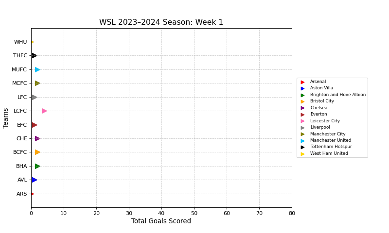

# WSL 2023–24 Goals Race

An animated "race" of all 12 teams in England's Women's Super League (WSL) 2023–24 season, showing goals piling up matchweek by matchweek, plus a statistical breakdown of how each team scored.

**Solo project** for DS2500 (Intermediate Programming with Data), Northeastern University, Fall 2025.



## What it does

- **Object-oriented design:** each team is a `Team` object that stores its goals per match, tracks its position, draws itself on the chart, and moves forward by the goals it scored that week
- **Animation:** steps through all 22 matchweeks, moving each team right by its goals, and saves the race as a GIF
- **Statistics written from scratch** (no NumPy or statistics library): mean, variance, standard deviation, median, mode, coefficient of variation, scoring streaks, and first-half vs second-half averages

## Results

| Question | Answer |
|---|---|
| Most goals in the season | **Chelsea**, 71 goals |
| Average season total per team | 36.42 goals (standard deviation 16.16) |
| Arsenal's median goals per game | 2 |
| Tottenham Hotspur's most common score | 1 goal |
| Most consistent scorer (lowest coefficient of variation) | **Chelsea** (0.58) |
| Longest streak of 2+ goals per game | **Arsenal**, 8 games in a row |
| Biggest second-half improvement | **Everton**, +0.36 goals per game |

Chelsea didn't just score the most; they also scored the most *reliably* from week to week.

## How to run

Requires Python 3.9+.

```bash
pip install -r requirements.txt
python wsl_goals_analysis.py
```

The race plays in a window (about 11 seconds) and is saved to `figures/wsl_goals_race.gif`. Close the window to see the statistics printed in the terminal.

## Data

`wsl_goals_2324.csv` has one row per team and one column per matchweek (1–22), with the number of goals each team scored in that match. Blank cells mean 0 goals.
